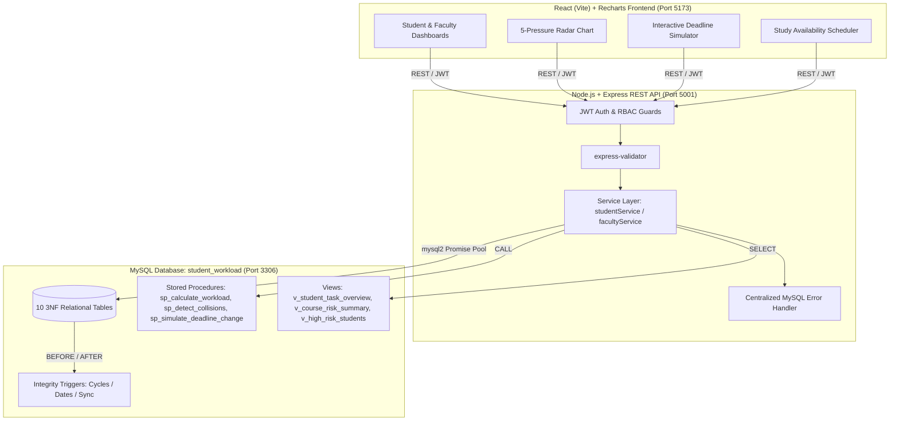

# Student Workload & Deadline Collision Analyzer

A production-grade, full-stack DBMS course project that proactively identifies student academic overload, detects deadline clustering across concurrent courses, and provides faculty with an interactive "what-if" deadline collision simulator.

---

## Architecture Overview



---

## Technology Stack

- **Database**: MySQL 8.0+ / 9.x+ (Local server, Database: `student_workload`, root user with empty password)
- **Backend**: Node.js (v20+), Express 4.x, `mysql2` (Promise Connection Pool), `bcrypt`, `jsonwebtoken`, `cors`, `express-validator`
- **Frontend**: React 18, Vite, React Router v6, Recharts (Radar, Area, Bar charts), Modern Custom CSS Design System
- **Testing**: Jest + Supertest integration test suite

---

## Quick Start (Step-by-Step)

### 1. Prerequisites
- MySQL local server running on `localhost:3306` (accessible via `mysql -u root` without password)
- Node.js (v18+) and npm installed

### 2. One-Command Database Provisioning
Run the automated idempotency shell script from the project root:
```bash
./setup_db.sh
```
This runs:
1. `db/schema/001_schema.sql` (Creates all 10 tables with foreign keys and check constraints)
2. `db/logic/001_views.sql` (Creates database views)
3. `db/logic/002_procedures.sql` (Compiles stored procedures)
4. `db/logic/003_triggers.sql` (Installs integrity and sync triggers)
5. `db/seed/seed.sql` (Seeds 2 faculty, 8 students, 4 courses, 12 tasks, and realistic relative dates)

### 3. Run Backend Server
```bash
cd backend
npm install
npm run dev
```
Backend API will start at: `http://localhost:5001`
Health check: `http://localhost:5001/api/health`

### 4. Run Backend Integration Tests
In a separate terminal:
```bash
cd backend
npm test
```
All 19 Supertest tests covering Auth, Student workflow, Faculty workflow, and the Simulation engine will execute.

### 5. Run Frontend Development Server
```bash
cd frontend
npm install
npm run dev
```
Frontend will be available at: `http://localhost:5173`

---

## Demo Credentials (All Passwords: `password123`)

For evaluation convenience, the Login page features **1-Click Demo Login** buttons for all primary user personas:

| Role | Username | Email | Key Showcase Feature |
|---|---|---|---|
| **Faculty** | `dr_sarah` | `sarah@university.edu` | Teaches CS401 (DBMS) & CS601 (Cloud). Full access to Deadline Simulator and Course Risk views. |
| **Faculty** | `prof_raj` | `raj@university.edu` | Teaches CS402 (OS) & CS602 (ML). Simulates deadline adjustments for concurrent courses. |
| **Student** | `alice_wong` | `alice@university.edu` | Semester 4. Exhibits **HIGH / CRITICAL** workload risk with active `DEADLINE_CLUSTER` and `OVERLOAD` collisions. |
| **Student** | `bob_martinez` | `bob@university.edu` | Semester 4. Highly constrained study availability (15h) triggering severe `OVERLOAD`. |
| **Student** | `charlie_kim` | `charlie@university.edu` | Semester 4. Moderate workload, partially completed tasks. |
| **Student** | `diana_prince` | `diana@university.edu` | Semester 4. Balanced workload with ample logged study blocks. |
| **Admin** | `admin_system` | `admin@university.edu` | System administration access. |

---

## Core Academic & Mathematical Engine

### 1. The 5-Dimensional Pressure Model
Each dimension is normalized on a $0$ to $100$ scale:
1. **Temporal Pressure (25%)**: Evaluates deadline concentration. Formula: $\min\left(100, \frac{\text{Tasks Due}}{\text{Window Days}} \times 7 \times 20\right)$.
2. **Workload Pressure (30%)**: Ratio of remaining required hours to logged study hours. Formula: $\min\left(100, \frac{\text{Required Hours}}{\text{Available Study Hours}} \times 100\right)$.
3. **Cognitive Pressure (15%)**: Average mental strain: $\text{Avg}(\text{Difficulty [1-5]} \times \text{Cognitive Load [1-10]})$. Max product 50 scaled to 100%.
4. **Assessment Pressure (20%)**: Sum of course grade weights (%) due in the window.
5. **Dependency Pressure (10%)**: Unfinished prerequisite bottleneck penalty ($25\%$ per uncompleted prerequisite).

$$\text{Overall Risk Score} = (0.25 \times P_T) + (0.30 \times P_W) + (0.15 \times P_C) + (0.20 \times P_A) + (0.10 \times P_D)$$

### 2. Risk Level Thresholds
- **`LOW`**: $< 30.00\%$
- **`MEDIUM`**: $30.00\% - 54.99\%$
- **`HIGH`**: $55.00\% - 74.99\%$
- **`CRITICAL`**: $\ge 75.00\%$

### 3. Collision Detection Rules
- **`DEADLINE_CLUSTER`**: Triggered when 3 or more uncompleted deadlines fall within any 48-hour window.
- **`OVERLOAD`**: Triggered when required task hours exceed logged study availability ($P_W > 100\%$).
- **`ASSESSMENT_OVERLAP`**: Triggered when 2 or more assessments due within 24 hours have a cumulative grade weight $\ge 25\%$.

### 4. What-If Deadline Simulator
Faculty can choose any assignment and propose a hypothetical deadline. Stored procedure `sp_simulate_deadline_change`:
- Dynamically recalculates cohort risk for all enrolled students without altering live production task records.
- Outputs net $\text{Impact Score} = \text{Projected Risk} - \text{Original Risk}$.
- Formulates decision guidance: `APPROVE`, `NOT RECOMMENDED`, or `SUGGEST ALTERNATE DATE`.

---

## Database Triggers & Integrity Enforcements

1. **`trg_prevent_circular_dependencies` (BEFORE INSERT on `TASK_DEPENDENCIES`)**:
   Uses recursive Common Table Expressions (`WITH RECURSIVE`) to traverse prerequisite dependency trees and reject cyclic chains (e.g. $A \rightarrow B \rightarrow C \rightarrow A$) via `SIGNAL SQLSTATE '45000'`.
2. **`trg_tasks_deadline_check_insert` & `update` (BEFORE INSERT/UPDATE on `TASKS`)**:
   Enforces that `deadline_datetime` is strictly greater than `release_datetime`.
3. **`trg_student_tasks_after_insert` (AFTER INSERT on `STUDENT_TASKS`)**:
   Automatically re-evaluates workload analysis and detects collisions whenever a new task is distributed to a student.

---

## Design Choices & Assumptions (Viva Notes)

1. **Course Enrollment Rule**: As per specification, a student is enrolled in a course when `STUDENTS.semester = COURSES.semester`.
2. **Baseline Study Availability**: If a student has not yet entered custom availability blocks in `AVAILABILITY`, the stored procedure assumes a standard baseline of 4 hours per day so students are not penalized before setting up their calendar.
3. **Relative Seed Dates**: All seeded deadlines and availability blocks use MySQL relative date arithmetic (`DATE_ADD(NOW(), INTERVAL ...)`) to ensure the demo data remains active, realistic, and perpetually testable regardless of when the project is evaluated.

