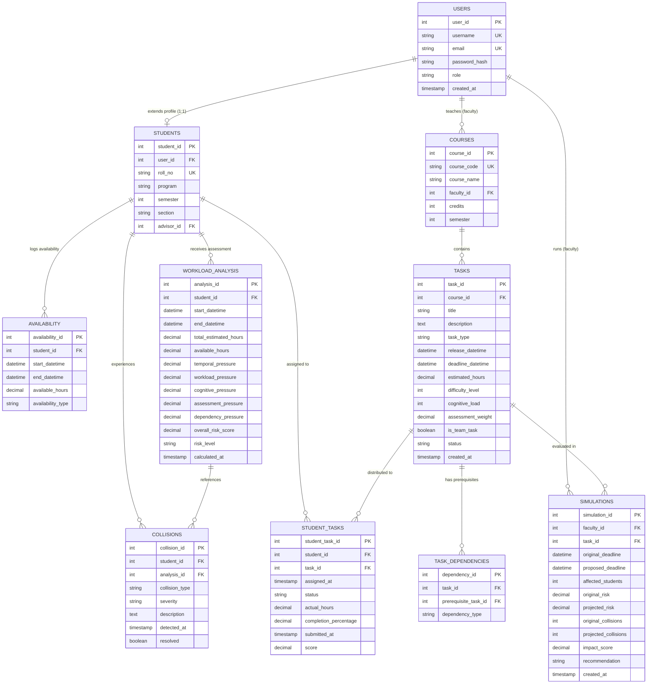

# Database Schema & Entity-Relationship Architecture

## Relational Schema Diagram

## Relational Design Decisions & Normalization

1. **Third Normal Form (3NF)**:
   - All transitive and partial dependencies have been removed.
   - User authentication and common credentials reside in `USERS`. Student specific attributes (`roll_no`, `program`, `semester`, `section`, `advisor_id`) are partitioned into `STUDENTS`.
2. **Implicit Semester-Based Enrollment**:
   - As per project specifications, a student is enrolled in a course if `STUDENTS.semester = COURSES.semester`. This eliminates unnecessary join overhead while matching realistic academic batch cohorts.
3. **Integrity Enforcement**:
   - Foreign key constraints ensure cascade deletes on dependent task entities and nullification on optional advisors.
   - Check constraints enforce valid roles (`student`, `faculty`, `admin`), bounded ratings (`difficulty_level BETWEEN 1 AND 5`), progress percentages (`completion_percentage BETWEEN 0 AND 100`), temporal validity (`end_datetime > start_datetime`), and non-reflexive task dependencies (`task_id <> prerequisite_task_id`).

